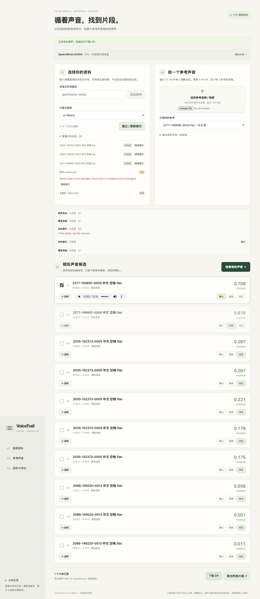

# VoiceTrail

Find similar voices in a local media library, listen at the original timestamps, review candidates and export the original audio.

[中文说明](README.zh-CN.md) · [Specification](PROJECT_SPEC.md) · [Evidence](docs/EVIDENCE.md) · [Licenses](docs/THIRD_PARTY.md)

**v0.1.0-alpha.1 is a local technical preview.** Search uses a real, pinned SpeechBrain ECAPA model on CPU. Cosine similarity is a ranking score, not an identity probability. The interface is currently in Chinese.



## Run locally

Prerequisites: Python **3.11**, Node **24 LTS** with npm, [uv](https://docs.astral.sh/uv/) **0.13.6 or newer**, and FFmpeg/FFprobe on PATH. On macOS with Homebrew:

```sh
brew install python@3.11 node@24 ffmpeg uv
```

On Linux install Python 3.11, Node 24, uv and your distribution's FFmpeg/libsndfile packages first. Linux engineering tests run in CI; real voice/browser performance is measured on macOS ARM64. The launcher uses POSIX file locking; Windows is not supported in this preview.

```sh
git clone https://github.com/Xiangyu2141480/voicetrail.git
cd voicetrail
uv sync --locked --python 3.11
npm ci --prefix frontend
npm run build --prefix frontend
.venv/bin/python -m scripts.prepare_model
.venv/bin/python -m scripts.dev
```

Open **http://127.0.0.1:8765**. Keep the terminal running; Ctrl+C stops the service. The single launcher starts one API instance and one background worker, serving the built frontend on the same origin.

The first model preparation downloads **83,316,686 bytes** from the pinned Hugging Face model repository, verifies SHA256 and loads only tensor weights into the installed architecture. No remote YAML/Python is executed. Preparation reports measured download progress; failures exit nonzero. After preparation, confirm offline loading:

```sh
HF_HUB_OFFLINE=1 .venv/bin/python -m scripts.prepare_model --offline
HF_HUB_OFFLINE=1 .venv/bin/python -m scripts.dev
```

Application data is outside the checkout: `~/Library/Application Support/VoiceTrail` on macOS, `~/.local/share/voicetrail` on Linux. `VOICETRAIL_DATA` selects another data directory; `VOICETRAIL_PORT` changes the loopback port. Models, SQLite, references, previews and exports remain local. Model preparation contacts Hugging Face; ordinary indexing/search/export use local files. No cloud inference is used.

## Use

1. Paste an explicitly selected local folder path, add it, then build/update its index. The browser cannot grant native folder access; the locally running backend reads the selected path.
2. Upload a reference containing one speaker, preferably 10–30 seconds. The accepted range is 3–60 seconds with at least 3 seconds of detected speech.
3. Search, play candidates and mark them confirmed/rejected/undecided. Similarity never automatically confirms identity.
4. Select candidates and download a ZIP of 16 kHz mono PCM16 WAV clips plus `manifest.json`, with source fingerprints and original timestamps.

Re-scans preserve unchanged index generations. Interrupted tasks become `interrupted` after restart and require explicit retry. Per-file failures are visible; removing an asset removes its index registration without deleting the source. References, reviews and exports persist across restarts. Original source files are read-only; export decodes and re-encodes their original audio without synthesis or cloning.

## Verify

```sh
.venv/bin/python -m scripts.verify
```

This runs 24 engineering regressions with socket connections blocked, lint, HTTP contract consistency, TypeScript checks and production build. CI runs this same entry point. It does **not** validate speaker quality or substitute for the real release gates.

To reproduce all real checks, prepare the five frozen, licensed LibriSpeech samples outside the checkout and install the test browser:

```sh
.venv/bin/python -m scripts.prepare_evaluation
npm exec --prefix frontend -- playwright install chromium
.venv/bin/python -m scripts.verify --real --report docs/verify_results.json
```

`prepare_evaluation` streams the official dev-clean archive, retains only samples matching the frozen manifest, and creates separate synthetic fixtures for error handling. A complete local archive can be supplied with `--archive`; `--offline` requires already verified samples. Downloads may read a substantial part of the archive. The real gate requires every sample and cached model: missing prerequisites fail, with no mock fallback or skipped green result. It performs network-blocked model inference, frozen retrieval ordering, real API indexing/export/restart and Chromium playback, forced crash recovery, review persistence and export playback. Real checks update public evidence JSON/screenshots; sample audio and weights are never committed.

## Measured scope

On macOS 26.5.1 ARM64, Apple M5 Pro, 48 GiB RAM, CPU/4 threads:

- Frozen set: five English clean audiobook utterances, three speakers. Both known speakers' positive from another chapter ranked above all known/unknown negatives. Full scores: [retrieval_results.json](docs/retrieval_results.json).
- Initial real API measurement: 53.065 seconds of source audio, 3 files, 10 windows; indexing 2.412 seconds, unchanged scan 0.329 seconds, search about 0.010 seconds. Peak process RSS about 1.06 GB. These small cached measurements are not a capacity benchmark.
- Actual browser previews and exported WAVs decoded and played; cancellation, SIGKILL/retry, restarts, Chinese/space paths, short/silent/no-audio errors, 390px layout and keyboard search passed. [API](docs/api_results.json), [browser](docs/e2e_results.json), [ego-browser](docs/ego_results.json).

Different chapters are different recordings, but do not establish independent environments or cross-year recognition. Chinese speech, noisy family videos, overlapping speakers, cross-age recognition, large libraries, other hardware and human adoption remain unverified. Segmentation is not diarization. No general accuracy/recall, identity-certainty or time-saving claim is made.

## Development and licensing

FastAPI/SQLite/NumPy backend; React/TypeScript/Vite frontend; FFmpeg normalization/export; pinned ECAPA embeddings; WebRTC VAD with 10-second windows and 5-second hop. Model/preprocessing versions and source fingerprints are stored with segments.

For frontend development run `npm run dev --prefix frontend` and start the API with `VOICETRAIL_DEV_UI=1 .venv/bin/python -m scripts.dev`. The explicitly enabled development origin is `http://127.0.0.1:5173`. Update HTTP types with `.venv/bin/python -m scripts.contracts` after schema changes.

Original code is MIT. Dependencies, model weights and samples retain their licenses. [THIRD_PARTY.md](docs/THIRD_PARTY.md) includes the full locked dependency inventory and preserved upstream notices. The release distributes source and documentation, not dependency binaries, model weights or audio. Desktop packaging, cloud sync, model training and video export are outside v0.1.
